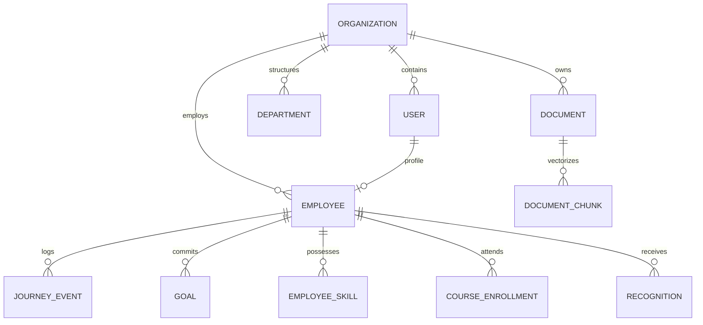

# EJC System Architecture & Engineering Specifications

This document outlines the detailed system architecture, database design, event pipeline, and multi-tenant security model for **Employee Journey Cloud (EJC)**.

---

## 1. Domain Model & Relational Schema

EJC connects all HR subsystems through the **Journey Event Graph**:



### Key Principles:
1. **Multi-Tenancy Enforcement**: Every core entity contains a foreign key to `Organization`. The backend middleware extracts the authenticated user's `organizationId` from JWT and validates that cross-tenant access is prohibited.
2. **Event-Driven Journey Progression**: Mutating actions (completing onboarding tasks, verifying a skill, achieving a goal, finalizing a review, or executing a promotion) emit a `JourneyEvent` to the employee's chronological timeline.

---

## 2. Journey Event Engine Pipeline

```
[User / Lifecycle Action]
       │
       ▼
[Service Mutation (e.g. Complete Onboarding Task)]
       │
       ▼
[JourneyService.emitEvent]
       ├── Validates Tenant Scope
       ├── Persists JourneyEvent (Stage, Category, Description, Actor, Timestamp)
       ├── Triggers In-App Notification
       └── Dispatches Audit Log Record
```

---

## 3. Retrieval-Augmented Generation (RAG) Architecture

The AI subsystem provides authorized contextual answers without exposing confidential cross-tenant or out-of-role data:

1. **Ingestion Layer**:
   - HR Admin uploads policies via `/api/documents/ingest`.
   - Text is normalized and split into paragraph chunks.
   - Embeddings are generated and stored in PostgreSQL with the `pgvector` extension.
2. **Retrieval & Guardrail Layer**:
   - When a query is received, the RAG retriever filters candidate vectors strictly by `organizationId = user.organizationId` and `accessLevel IN (user.allowedLevels)`.
   - Cosine similarity identifies the top matching chunks.
3. **Agent Synthesis**:
   - The AI Assistant synthesizes an answer referencing the retrieved document titles and excerpts, accompanied by interactive context pills and recommended next steps.

---

## 4. Production Deployment & Infrastructure

- **Multi-stage Docker Builds**: Optimized Alpine base images separating dependencies, build artifacts, and runtime environments.
- **Reverse Proxy**: Nginx proxies `/api` calls to the Express backend and serves static Vite assets with client-side SPA fallback.
- **Kubernetes**: Scalable deployment with liveness and readiness probes, resource boundaries, ConfigMaps, and cluster secrets.
